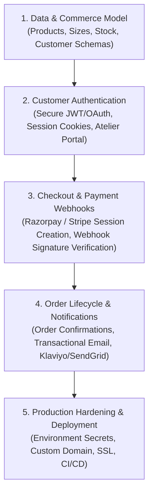

# WAAK Occasionwear — Phase 2 Architecture & Commerce Strategy

**Baseline:** `waak-v3.1-client-preview` (`ae75687`)  
**Development Branch:** `phase2-backend`  
**Purpose:** Strategic architectural decision guide for client sign-off and Phase 2 backend planning.

---

## 1. Key Architectural Decision: Custom Backend vs Managed Commerce

Before writing backend code, the client must decide between a **Custom Commerce Engine** and a **Managed Headless Platform**. This choice directly impacts development timeline, compliance scope, inventory operations, and long-term operating costs.

| Evaluation Metric | Option A: Custom Headless Backend (Node.js / Express / Next.js API + PostgreSQL) | Option B: Managed Headless Platform (Shopify Storefront API / Medusa.js) |
| :--- | :--- | :--- |
| **Best Suited For** | Completely bespoke tailoring workflows, custom measurement consultations, bespoke bridal appointments. | Fast production launch, built-in catalog management, out-of-the-box PCI compliance, mobile app order management. |
| **Catalog & Inventory** | Custom SQL schemas (`products`, `variants`, `inventory_levels`). Custom admin dashboard needed. | Native admin portal with rich product variation, automated low-stock alerts, and multi-location fulfillment. |
| **Payment & Taxes** | Direct Stripe / Razorpay API integration with custom server-side webhook handlers. | Pre-certified checkout or headless payment processing with automated GST / international tax handling. |
| **Security & PCI DSS** | High developer responsibility for tokenization, auth encryption, and server hardening. | Tier 1 PCI compliance handled natively by platform. |
| **Estimated Sprint Velocity** | 3–4 weeks for initial MVP order lifecycle. | 1–2 weeks utilizing existing Storefront APIs. |
| **Recommendation** | **Recommended if** WAAK's business model is 100% bespoke tailoring consultations with non-standard sizing forms. | **Recommended (Default)** for standard occasionwear e-commerce with fast time-to-market and low infrastructure overhead. |

---

## 2. Phase 2 Implementation Sequencing

Once the commerce strategy is confirmed, technical execution should proceed strictly in this order:

### Detailed Sequence:
1. **Data Model & Catalog Service**:
   - Establish schemas for SKU, size variations (`38`, `40`, `42`, `44`), stock allocations, and order line items.
   - Replace static `src/data/products.ts` with API-driven or GraphQL queries.
2. **Authentication & Session Security**:
   - Transition [`src/Account.tsx`](file:///c:/Users/Takemichi/Desktop/Waak%20Shop%20Web/src/Account.tsx) to HTTP-only cookie sessions.
   - Implement password hashing (Argon2 / bcrypt) and rate-limited endpoints.
3. **Checkout & Payment Gateway**:
   - Server-side order creation before initiating payment.
   - Robust webhook handling verifying cryptographic signatures to prevent order spoofing.
4. **Transactional Email & CRM**:
   - Automated order confirmation, invoice generation with Indian GST compliance, and newsletter subscription dispatch.
5. **Production Deployment & Verification**:
   - DNS configuration, SSL, CSP headers, and automated end-to-end checkout test runs.

---

## 3. Preserving the V3.1 Baseline

- The presentation branch `master` remains pinned to tag `waak-v3.1-client-preview`.
- All Phase 2 experiments and API connections must be committed exclusively to `phase2-backend`.
