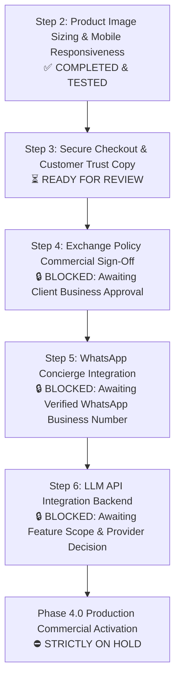

# WAAK — Client Requirements Step 2: Remaining Issues & Next Steps
**Scope:** Status of Remaining Client Requirements & Launch Gates  
**Branch:** `feature/client-req-step-2-responsive`  
**Date:** November 2026  
**Status:** Step 2 Complete; Subsequent Steps Gated by Client Approval

---

## 1. Step 2 Resolution Status

The visual and responsive improvements requested by the client in Step 2 have been fully implemented, visually verified across seven device viewports, and backed by 325 passing automated tests:

- [x] Product photos no longer appear too large on desktop (capped at 480px catalog / 580px PDP).
- [x] Mobile catalog transformed from single-column 320px blowout to high-fashion 2-column grid.
- [x] PDP main image capped at 380px on mobile, preserving above-the-fold visibility for title, price, and CTA.
- [x] Category navigation equipped with native horizontal scroll snapping.
- [x] Checkout modal City, State, and PIN Code fields made fully responsive (2 columns + full-width PIN).
- [x] All touch targets audited and elevated to $\ge 44 \times 44\text{px}$.
- [x] All 7 regression suites (325 assertions) pass with 0 failures.

---

## 2. Outstanding Client Requirements (Steps 3–6)

The remaining client requirements from the initial WhatsApp screenshot were intentionally segregated to avoid mixing visual polish with commercial and architectural decisions.

### Step 3 — Secure Checkout & Customer Trust Copy
- **Current State:** Checkout modal displays "🔒 256-bit encrypted checkout with server-side HMAC signature verification".
- **Pending Decision:** Review trust badges and copy with client.
- **Rule:** Do not add unverified certifications (such as PCI Level 1 or ISO logos) until actual certificates exist. Keep trust explanations grounded in actual technical protections.

### Step 4 — Exchange Policy Approval Items
- **Current State:** Policy pages show prominent "Unapproved Draft Policy (Pending Corporate Confirmation)" warning banners.
- **Pending Decision:** Client sign-off required on:
  1. Exact exchange/alteration timeframe (7 days vs 14 days).
  2. Eligibility: Standard sizes (38–44) vs made-to-measure / bespoke commissions.
  3. Reverse pickup logistics carrier and transit liability.
  4. Store credit vs refund policy for ceremonial orders.
- **Action:** Retain draft notice banners until written corporate sign-off is provided.

### Step 5 — WhatsApp Concierge Integration
- **Current State:** No floating WhatsApp widget or unsolicited live action routing.
- **Pending Dependency:** Client must supply:
  1. Verified WhatsApp Business phone number (in E.164 format, e.g. `+91 98XXX XXXXX`).
  2. Approved pre-filled message template (e.g., `"Hello WAAK Atelier, I would like to inquire about [Garment Name] (Ref: [Product ID])."`).
  3. Operating hours for client concierge response.
- **Action:** Implement clean `https://wa.me/` direct link once phone number is provided.

### Step 6 — LLM API Integration in Backend
- **Current State:** Architecture documented in `reports/client-requirements/LLM_INTEGRATION_DECISION.md`.
- **Pending Decision:** Client must define:
  1. **Primary Use Case:**
     - Option A: *AI Sartorial Stylist & Bespoke Recommendation Engine* (recommends matching accessories, dupattas, turbans, footwear based on occasion/time).
     - Option B: *Client Concierge FAQ & Sizing Assistant* (answers chest measurement queries, garment care questions, and dispatch windows).
     - Option C: *Atelier Internal Assistant* (admin-only summarization of orders and stock alerts).
  2. **Provider & Credentials:** Google Gemini API vs OpenAI vs Anthropic; API key provisioning and secure `.env` storage.
  3. **Data Safety:** Patron PII (names, phone numbers, exact addresses) must never be sent to third-party LLM endpoints.

---

## 3. Phase 4.0 Production Launch Gates (Strictly Retained)

The following four P1 launch blockers remain strictly in effect:

1. **Gate 1 — Production Payment Gateway:** Razorpay remains locked in `TEST` sandbox mode. Real customer credit cards cannot be charged.
2. **Gate 2 — Legal & Commercial Policies:** Policies remain marked as unapproved drafts until formal executive authorization.
3. **Gate 3 — Verified WhatsApp Number:** Live chat routing remains disabled.
4. **Gate 4 — Production Domain & SSL:** Staging environment remains isolated at `http://localhost:8088` and `http://localhost:9001`.
