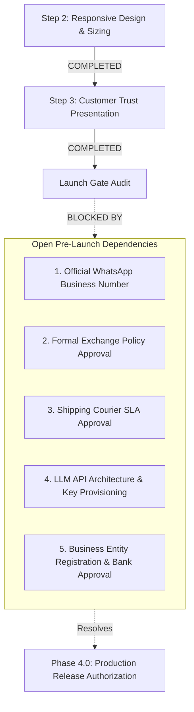

# WAAK Remaining Issues & Launch Gate Status — Step 3
## Outstanding Business Approvals, Technical Dependencies & Roadmap to Phase 4.0

**Project:** WAAK Atelier E-Commerce Web Storefront  
**Phase:** Client Requirements Remediation — Step 3  
**Audit Date:** November 4, 2026  
**Operational Status:** **Controlled Staging Only** (Phase 4.0 strictly ON HOLD)  

---

### 1. Launch Gate Status Summary

While Step 3 has successfully implemented all requested responsive sizing and customer trust presentations, **the application must remain strictly in Controlled Staging Only**. 

Real commercial orders cannot be authorized until the business blocks detailed below are formally signed off by the brand owners.

---

### 2. Outstanding Dependencies & Action Items

| ID | Issue Description | Severity | Current Mitigation in Codebase | Required Client Action |
| :---: | :--- | :---: | :--- | :--- |
| **B-01** | **WhatsApp Business Number Unset** | **P1 Blocker** | `WhatsAppInquiryButton` is strictly gated to `VITE_WHATSAPP_NUMBER`. It renders `null` (zero DOM footprint) to prevent dead links. | Client must supply the official registered WhatsApp Business number (e.g. `+91 98XXX XXXXX`). |
| **B-02** | **Exchange Policy Unapproved** | **P1 Blocker** | Links to `/returns-and-exchanges` and on-page notices are clearly tagged with an explicit **"Draft Policy"** warning. | Atelier management must approve final exchange window (e.g. 7 vs 14 days), condition rules, and alteration policies. |
| **B-03** | **Shipping SLA & Courier Contracts** | **P2 Operational** | Links to `/shipping-policy` are marked with **"Draft Policy"**. Checkout displays standard estimated timeline disclaimer. | Confirm commercial logistics partner (Blue Dart, Delhivery) and return pickup procedures. |
| **B-04** | **LLM API Integration Scope** | **P2 Operational** | Implementation deliberately held behind approval gate to avoid ungrounded API spend and architectural rework. | Select intended use case (e.g. Atelier Stylist Concierge, Order Status Chatbot, or Internal Catalog Tagging) and provider. |
| **B-05** | **Live Payment Gateway Activation** | **P0 Security** | Razorpay keys strictly locked to `rzp_test_waak2026demo` via `payment_guard.ts`. Checkout displays **Staging Sandbox · Test Mode**. | Multi-party sign-off, live Razorpay KYC approval, production domain verification, and secret rotation before live credentials. |

---

### 3. Verification of Preserved Baselines

1. **Client Preview Baseline (`waak-v3.1-client-preview`)**:
   - Commit: `097dfb1`
   - Direct ancestry: Fully preserved. No history rewriting, rebasing, or force-pushes occurred.
2. **Step 2 Baseline (`af78a7c`)**:
   - Direct parent of `feature/client-req-step-3-trust`.
3. **Database State**:
   - Schema version: `003_newsletter_and_security.sql`.
   - Migration integrity: Fully synchronized. All 16 variants populated with inventory.

---

### 4. Recommendation for Next Step

With Step 2 (Image Sizing & Responsiveness) and Step 3 (Customer Trust Presentation) successfully completed and audited, the development team recommends presenting the staging deployment to the client for:
1. **Visual review of product cards and PDP on their mobile devices**.
2. **Review of the security card in the checkout modal**.
3. **Decision on the WhatsApp business phone number**.
4. **Decision on the preferred LLM concierge use case**.
