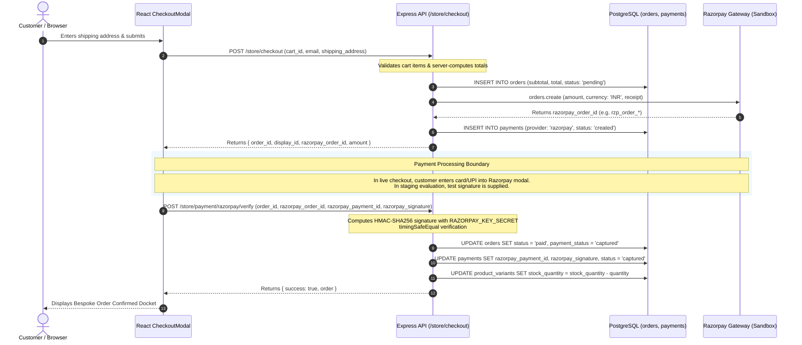

# WAAK Payment Data Flow & Architecture Verification
## Technical Verification of Payment Processing and Data Storage

**Project:** WAAK Atelier E-Commerce Web Storefront  
**Phase:** Client Requirements Remediation — Step 4  
**Audit Date:** November 4, 2026  
**Operating Environment:** Controlled Staging Only  
**Verified Files:**  
- `src/components/CheckoutModal.tsx`
- `backend/src/routes/checkout.ts`
- `backend/src/db/schema.sql`
- `backend/src/config.ts`

---

### 1. Payment Flow Verification

An exhaustive code audit was conducted on the checkout integration to verify that customer-facing trust claims accurately reflect the real data flows:

---

### 2. Database Schema Audit: Cardholder Data Storage

Inspection of PostgreSQL schema definitions in `backend/src/db/schema.sql`:

#### 2.1 `orders` Table Columns
- `id` (VARCHAR)
- `display_id` (VARCHAR, e.g. `WAAK-2026-9515`)
- `customer_id` (VARCHAR, nullable)
- `email` (VARCHAR)
- `status` (VARCHAR, e.g. `pending`, `paid`, `cancelled`)
- `fulfillment_status` (VARCHAR, e.g. `not_fulfilled`, `processing`, `fulfilled`)
- `payment_status` (VARCHAR, e.g. `awaiting`, `captured`)
- `subtotal` (INTEGER, paise/INR)
- `tax_total` (INTEGER)
- `shipping_total` (INTEGER)
- `total` (INTEGER)
- `currency_code` (VARCHAR, `INR`)
- `shipping_address` (JSONB: `first_name`, `last_name`, `phone`, `address_1`, `city`, `state`, `postal_code`, `country_code`)
- `created_at` / `updated_at` (TIMESTAMP)

#### 2.2 `payments` Table Columns
- `id` (VARCHAR)
- `order_id` (VARCHAR, FK -> `orders.id`)
- `provider_id` (VARCHAR, `'razorpay'`)
- `razorpay_order_id` (VARCHAR)
- `razorpay_payment_id` (VARCHAR)
- `razorpay_signature` (VARCHAR)
- `amount` (INTEGER)
- `currency` (VARCHAR, `'INR'`)
- `status` (VARCHAR, e.g. `'created'`, `'captured'`)
- `created_at` / `updated_at` (TIMESTAMP)

**Audited Result:** Zero columns exist for credit/debit card numbers (PANs), cardholder expiration dates, CVVs/CVCs, net banking passwords, or UPI MPINs. WAAK database tables store strictly gateway identifiers and HMAC signatures.

---

### 3. Alignment of Customer Trust Phrasing

The audited codebase directly supports the updated trust copy:

1. **"Server-Verified Pricing"**: Verified. Backend lines 80–94 in `backend/src/routes/checkout.ts` recalculate line item sums directly from PostgreSQL `product_variants` table, ignoring any client-supplied totals.
2. **"HMAC Signature Verification"**: Verified. Backend lines 180–188 in `backend/src/routes/checkout.ts` compute `crypto.createHmac('sha256', RAZORPAY_KEY_SECRET)` over `${razorpay_order_id}|${razorpay_payment_id}` and perform `crypto.timingSafeEqual`.
3. **"Direct Gateway Processing"**: Verified. Sensitive payment credentials transit through Razorpay's infrastructure; WAAK servers receive only the resulting payment IDs.
4. **"Staging Sandbox · Test Mode"**: Verified. `backend/src/config.ts` runtime guard enforces test key prefix `rzp_test_*` and blocks any production `rzp_live_*` keys.
