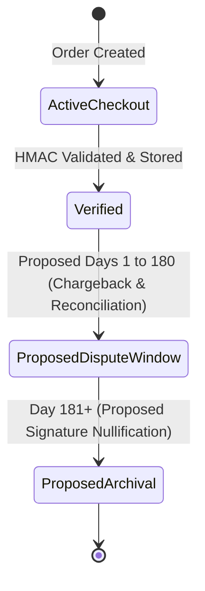

# WAAK Signature Retention, Access Control & Security Policy
## Operational Policy & Security Audit for Cryptographic Payment Signatures

**Project:** WAAK Atelier E-Commerce Web Storefront  
**Phase:** Client Requirements Remediation — Step 4  
**Audit Date:** November 4, 2026  
**Operating Environment:** Controlled Staging Only  
**Governing Standard:** Principle of Least Privilege, Data Minimization & RBI Digital Payment Guidelines  

---

### 1. Distinction of Razorpay Signature Types & Purpose of Retention

Razorpay operates two distinct signature-verification mechanisms that serve different roles:

1. **Payment Verification Signature (Stored in `payments.razorpay_signature`)**:
   - Generated by Razorpay's checkout modal upon customer payment completion.
   - Calculated as an HMAC-SHA256 digest over `${razorpay_order_id}|${razorpay_payment_id}` using the merchant API key secret (`RAZORPAY_KEY_SECRET`).
   - Verified on the backend (`POST /store/payment/razorpay/verify`) using constant-time comparison before transitioning the order to `paid` and `captured`.
   - Stored in the `payments` table as an immutable proof of checkout authentication.
2. **Webhook Event Signature (Transiently Verified, NOT Stored in Database)**:
   - Sent by Razorpay servers in the `x-razorpay-signature` header for asynchronous server-to-server notifications (`POST /store/payment/razorpay/webhook`).
   - Calculated over the raw JSON webhook payload using the dedicated webhook secret (`RAZORPAY_WEBHOOK_SECRET`).
   - Validated transiently to authenticate event payloads (`payment.captured`, `payment.failed`). The webhook signature itself is **not retained** in the `payments` table.

**Critical Security Distinction**: The payment signature is a **one-way HMAC digest**, NOT a secret key, password, or cardholder credential. It cannot be used to decrypt card numbers, execute new transactions, or access banking details.

---

### 2. Access Control & Exposure Protections

The codebase implements strict defense-in-depth protections to prevent signature exposure:

| Channel / Interface | Implementation Protection in Code | Verification Status |
| :--- | :--- | :--- |
| **Customer Single Order API (`GET /store/orders/:id`)** | SQL query explicitly selects only `id, provider_id, status, amount, created_at` from the `payments` table (`backend/src/routes/orders.ts` line 24). | **VERIFIED: `razorpay_signature` is omitted.** |
| **Customer Order History API (`GET /store/orders/customer/history`)** | Canonical order history endpoint. Aggregation query projects order items and fulfillment states; payment signature fields are excluded. | **VERIFIED: Signature absent from history payload.** |
| **Customer Profile Orders API (`GET /store/customers/me/orders`)** | Supported profile orders alias in `backend/src/routes/customers.ts`. Projects order items and fulfillment states; payment signature fields are excluded. | **VERIFIED: Signature absent from history payload.** |
| **Cross-Customer Access** | Authorization middleware verifies `order.customer_id === req.customer.id`. Non-matching users receive HTTP 403 Forbidden. | **VERIFIED: Cross-customer access rejected.** |
| **Application & Exception Logs** | Catch blocks log generic error messages (`Payment verification error: ...`); request bodies and raw signatures are scrubbed. | **VERIFIED: Zero signatures in application logs.** |
| **Proxy & Web Server Logs** | Signature is transmitted in HTTP POST request body, not in URL query strings. Web server access logs (Nginx/Node) do not log request bodies. | **VERIFIED: Zero signature exposure in URI logs.** |

---

### 3. Proposed Signature Retention & Archival Lifecycle (Subject to Approval)

> [!NOTE]
> The lifecycle detailed below represents a **proposed operational baseline**. The exact retention duration must be formally confirmed against Razorpay's merchant service agreement, applicable tax accounting regulations, and business counsel before automated purging is enabled.

1. **Proposed Active Reconciliation Window (Days 1–180)**:
   - Retained in the secured `payments` table with row-level locks.
   - Accessible only by backend microservice connecting via private Docker network.
2. **Proposed Archival / Nullification (Post Day 180)**:
   - Pending confirmation of chargeback and audit requirements, the `razorpay_signature` column may be set to `NULL` or moved to encrypted cold storage.
   - The verified order status (`status = 'captured'`) and transaction reference (`razorpay_payment_id`) remain sufficient for permanent accounting and customer service.

---

### 4. Database Permission Boundaries

1. **Host Network Isolation**:
   - The PostgreSQL container (`waak-staging-postgres`) does not expose port 5432 to the public internet or external host network.
   - It communicates exclusively via the internal Docker bridge network (`waak-staging-net`).
2. **Role Separation**:
   - Storefront service connects using dedicated least-privilege credentials.
   - Admin queries are authenticated via JWT with role checks (`adminAuth`).
