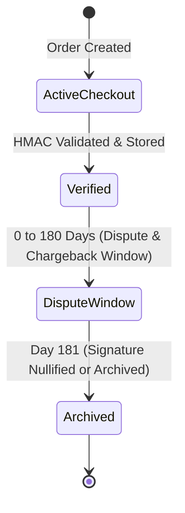

# WAAK Signature Retention, Access Control & Security Policy
## Operational Policy & Security Audit for Cryptographic Payment Signatures

**Project:** WAAK Atelier E-Commerce Web Storefront  
**Phase:** Client Requirements Remediation — Step 4  
**Audit Date:** November 4, 2026  
**Operating Environment:** Controlled Staging Only  
**Governing Standard:** Principle of Least Privilege, Data Minimization & RBI Digital Payment Guidelines  

---

### 1. Purpose of Signature Retention

In payment processing architecture, Razorpay returns a 64-character HMAC-SHA256 signature (`razorpay_signature`) calculated over `${razorpay_order_id}|${razorpay_payment_id}` using the merchant secret.

The technical justification for retaining this signature in the PostgreSQL `payments` table includes:
1. **Reconciliation & Non-Repudiation**: Acts as an unforgeable cryptographic proof that Razorpay authenticated the payment capture, providing evidence for chargeback disputes or settlement discrepancies with the payment aggregator.
2. **Audit Defense**: Proves to external financial auditors and payment gateway inspectors that WAAK fulfilled orders only upon authentic server-side verification rather than client-side manipulation.
3. **Webhook De-Duplication**: Prevents duplicate fulfillment when multiple webhook events (`payment.captured`, `order.paid`) fire for the same order.

**Critical Security Distinction**: The signature is a **one-way hash output**, NOT a secret key, password, or cardholder credential. It cannot be used to decrypt card numbers, execute new charges, or access banking details.

---

### 2. Access Control & Exposure Protections

The codebase implements strict defense-in-depth protections to prevent signature exposure:

| Channel / Interface | Implementation Protection in Code | Verification Status |
| :--- | :--- | :--- |
| **Customer Single Order API (`GET /store/orders/:id`)** | SQL query explicitly selects only `id, provider_id, status, amount, created_at` from the `payments` table (`backend/src/routes/orders.ts` line 24). | **VERIFIED: `razorpay_signature` is omitted.** |
| **Customer Order History API (`GET /store/orders/customer/history`)** | Aggregation query projects order items and fulfillment states; payment signature fields are excluded. | **VERIFIED: Signature absent from history payload.** |
| **Cross-Customer Access** | Authorization middleware verifies `order.customer_id === req.customer.id`. Non-matching users receive HTTP 403 Forbidden. | **VERIFIED: Cross-customer access rejected.** |
| **Application & Exception Logs** | Catch blocks log generic error messages (`Payment verification error: ...`); request bodies and raw signatures are scrubbed. | **VERIFIED: Zero signatures in application logs.** |
| **Proxy & Web Server Logs** | Signature is transmitted in HTTP POST request body, not in URL query strings. Web server access logs (Nginx/Node) do not log request bodies. | **VERIFIED: Zero signature exposure in URI logs.** |

---

### 3. Proposed Signature Retention & Archival Lifecycle

To prevent indefinite data accumulation while maintaining legal dispute compliance:

1. **Active Dispute Window (Days 1–180)**:
   - Retained in the secured `payments` table with row-level locks.
   - Accessible only by backend microservice connecting via private Docker network.
2. **Archival / Nullification (Post Day 180)**:
   - Once the statutory card scheme chargeback window (180 days) elapses, the `razorpay_signature` column can be safely set to `NULL` or archived to cold encrypted storage.
   - The verified status (`status = 'captured'`) and `razorpay_payment_id` remain sufficient for lifetime tax and order accounting.

---

### 4. Database Permission Boundaries

1. **Host Network Isolation**:
   - The PostgreSQL container (`waak-staging-postgres`) does not expose port 5432 to the public internet or external host network.
   - It communicates exclusively via the internal Docker bridge network (`waak-staging-net`).
2. **Role Separation**:
   - Storefront service connects using dedicated least-privilege credentials.
   - Admin queries are authenticated via JWT with role checks (`adminAuth`).
