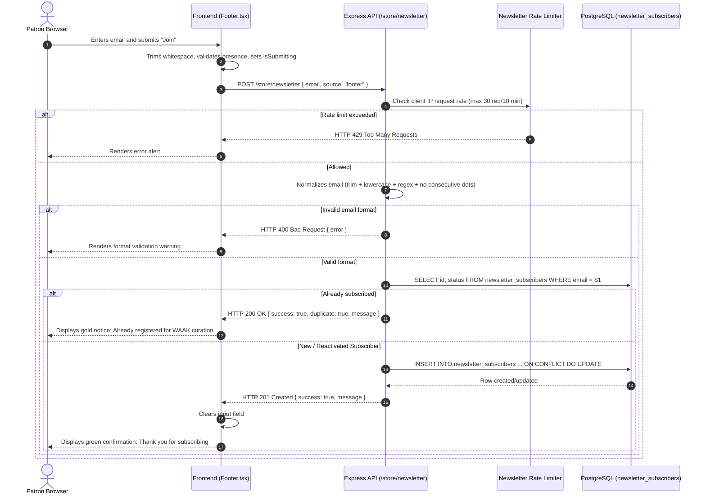

# WAAK Phase 3.4 — Newsletter Architecture & Persistence Specification
**Phase:** 3.4 — Newsletter Backend Persistence & Client Integration  
**Date:** November 3, 2026  
**Status:** FULLY IMPLEMENTED & TESTED  

---

## 1. Architectural Overview

The newsletter subscription system provides a production-ready patron capture funnel for WAAK's seasonal drops and bridal atelier invitations. It replaces the previous client-only simulation with persistent PostgreSQL storage, strict input validation, rate limiting, and an accessible frontend experience.



---

## 2. Database Schema (`003_newsletter_subscribers.sql`)

```sql
CREATE TABLE IF NOT EXISTS newsletter_subscribers (
    id VARCHAR(64) PRIMARY KEY,
    email VARCHAR(255) UNIQUE NOT NULL,
    status VARCHAR(50) DEFAULT 'subscribed',  -- 'subscribed', 'unsubscribed', 'bounced'
    source VARCHAR(100) DEFAULT 'footer',     -- 'footer', 'checkout', 'modal', 'concierge'
    consent_recorded BOOLEAN DEFAULT true,
    created_at TIMESTAMP WITH TIME ZONE DEFAULT NOW(),
    updated_at TIMESTAMP WITH TIME ZONE DEFAULT NOW()
);

CREATE INDEX IF NOT EXISTS idx_newsletter_subscribers_email ON newsletter_subscribers (email);
CREATE INDEX IF NOT EXISTS idx_newsletter_subscribers_status ON newsletter_subscribers (status);
```

### Key Properties:
- **`id`**: Unique string identifier (`sub_<timestamp>_<random>`).
- **`email`**: Unique constraint ensures no duplicate entries can ever be stored in the database.
- **`status`**: Allows graceful unsubscription or bounce tracking in future CRM phases without losing audit history.
- **`consent_recorded`**: Flags explicit opt-in for compliance with data protection standards.
- **`source`**: Identifies whether the patron joined via footer, checkout flow, or concierge consultation.

---

## 3. Security & Validation Rules

1. **Email Normalization**:
   - `email.trim().toLowerCase()`
   - Strict length limit: Max 255 characters (enforces RFC 5321 path limit).
   - Reject consecutive dots (`..`) in local-part or domain.
   - Simplified RFC 5322 regex validation.
2. **Rate Limiting (`newsletterRateLimiter`)**:
   - In-memory tracking per IP.
   - Max 30 attempts per 10-minute window per IP.
   - Returns standard HTTP 429 status with informative error message.
3. **SQL Injection Prevention**:
   - All queries use parameterized placeholders (`$1`, `$2`, `$3`).
   - No dynamic string concatenation in database queries.
4. **Accessible Frontend State**:
   - Form inputs disabled while `isSubmitting` is active.
   - Error feedback rendered with `role="alert"` and high-contrast styling (`#FCA5A5`).
   - Success and duplicate info feedback rendered with `role="status"` and `aria-live="polite"`.
